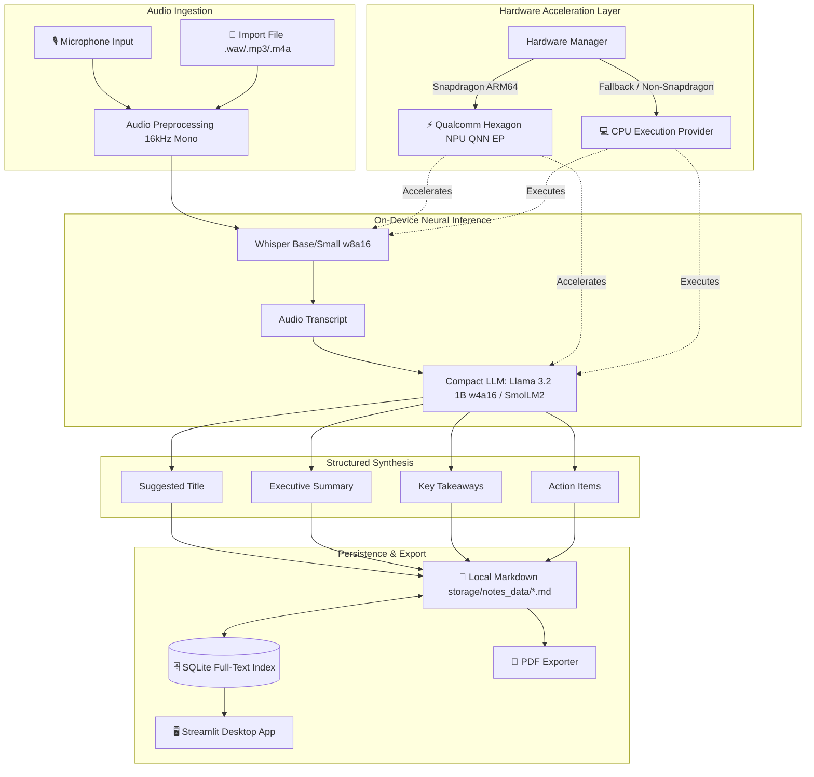

# OfflineMind 🧠

> **Private, Fully Offline On-Device AI Assistant for Voice Notes, Lectures, and Meetings**  
> *Engineered for Snapdragon-powered HP PCs (Windows on ARM) | Built for the Snapdragon AI Lab Build & Present Challenge*

---

## 📌 Problem & Vision

Professionals, students, and researchers record hours of lectures, brainstorms, and confidential meetings every week. Current solutions rely on third-party cloud AI APIs (OpenAI Whisper, cloud LLMs), introducing:
1. **Critical Privacy & Data Sovereignty Risks:** Confidential internal business discussions and medical/legal voice notes leave the device.
2. **Connectivity Dependency:** Cloud services fail in disconnected flight cabins, remote field sites, and low-connectivity lecture halls.
3. **API Costs & Rate Limits:** Cloud transcription and synthesis incur ongoing subscription and token fees.

**OfflineMind solves this by running 100% locally on Snapdragon HP PCs.** By harnessing the **Qualcomm Hexagon NPU** via the **ONNX Runtime QNN Execution Provider**, OfflineMind converts speech to text, synthesizes key insights, extracts action items, and generates structured notes with zero latency, zero cloud calls, zero accounts, and zero battery drain.

---

## 🌟 Key Features

- **🎙️ Flexible Audio Capture:** Record directly from your microphone or import existing `.wav`, `.mp3`, `.m4a`, or `.flac` recordings.
- **⚡ Hardware-Accelerated Transcription:** Speech-to-text powered by Snapdragon-quantized Whisper models running on the Hexagon NPU (HTP backend) with automatic CPU fallback.
- **🧠 Compact On-Device LLM Synthesis:**
  - 📌 **Suggested Title:** High-relevance, concise headline.
  - 📋 **Executive Summary:** Cohesive 2–4 sentence overview.
  - 💡 **Key Takeaways & Concepts:** Bullet points capturing essential concepts.
  - ✅ **Interactive Action Items:** Checkbox-ready follow-up deliverables.
- **🗄️ Local Markdown + SQLite Storage:**
  - All notes are saved locally as standard `.md` files with YAML frontmatter (Obsidian, Notion, and Git compatible).
  - High-speed SQLite database indexes metadata and tags for instant search.
- **📑 Multi-Format Export:** One-click download as clean Markdown or styled, paginated PDF documents generated with pure Python.
- **🔒 True Air-Gapped Privacy:** Zero network calls after initial model download. No telemetry, no API keys, and no user accounts.
- **💻 Universal Fallback:** Automatically detects Qualcomm Hexagon NPU (`QNNExecutionProvider`). If run on other PCs, smoothly falls back to `CPUExecutionProvider` or DirectML without code changes.

---

## 🏗️ Architecture



---

## 🤖 Models Used & Sources

All models are open-source and swappable via `models/config.yaml`:

| Task | Model | Source | Quantization | Target Accelerator |
| :--- | :--- | :--- | :--- | :--- |
| **Speech-to-Text** | `whisper_base_en` | Qualcomm AI Hub / Hugging Face | `w8a16` | Qualcomm Hexagon NPU (HTP) |
| **Speech-to-Text (Alt)** | `whisper_small_en` | Qualcomm AI Hub / Hugging Face | `w8a16` | Qualcomm Hexagon NPU (HTP) |
| **Speech-to-Text (Lite)**| `whisper_tiny_en` | Qualcomm AI Hub / Hugging Face | `fp16` | Hexagon NPU / CPU Fallback |
| **Summarization** | `llama_v3_2_1b_instruct` | Qualcomm AI Hub / Meta | `w4a16` | Qualcomm Hexagon NPU (HTP) |
| **Summarization (Lite)** | `smollm_135m_instruct` | Qualcomm AI Hub / Hugging Face | `fp16` | Hexagon NPU / CPU Fallback |
| **Summarization (Deep)** | `phi_3_5_mini_instruct` | Qualcomm AI Hub / Microsoft | `w4a16` | Qualcomm Hexagon NPU (HTP) |

To swap models, simply edit `models/config.yaml`.

---

## 🚀 Setup & Installation

### Option A: Windows on Snapdragon HP PCs (Recommended)

1. Open PowerShell and navigate to the project directory:
   ```powershell
   git clone https://github.com/<your-username>/OfflineMind.git
   cd OfflineMind
   ```

2. Run the one-click setup script:
   ```powershell
   .\setup.ps1
   ```
   *The script automatically verifies Python 3.11+, detects ARM64 architecture, creates a virtual environment, and installs dependencies including Qualcomm QNN Execution Provider packages.*

3. Launch OfflineMind:
   ```powershell
   .\run.ps1
   ```
   *(Or double-click `run.bat`)*

### Option B: Other Windows, macOS, or Linux Machines (CPU Fallback)

1. Clone and enter the repository:
   ```bash
   git clone https://github.com/<your-username>/OfflineMind.git
   cd OfflineMind
   ```

2. Run the setup script:
   ```bash
   chmod +x setup.sh
   ./setup.sh
   ```

3. Launch the app:
   ```bash
   source venv/bin/activate
   streamlit run app/main.py
   ```

---

## 📖 Usage Guide

1. **Record or Import:**
   - Go to **🎙️ Record & Import**.
   - Use the live microphone widget to record a thought, lecture, or meeting, OR drag and drop an audio file (`.wav`, `.mp3`, `.m4a`).
   - Click **⚡ Process Audio & Synthesize Note**.
2. **Review & Refine:**
   - Switch to **📝 Note Editor**.
   - Review the auto-generated Title, Executive Summary, Key Takeaways, Action Items, and Full Transcript.
   - Edit any section or check off completed tasks, then click **💾 Save Changes**.
3. **Search Your Knowledge Base:**
   - Open **📚 Notes Library & Search**.
   - Type any keyword (e.g. `architecture`, `budget`, `action`) or filter by tag to instantly find indexed notes.
4. **Export:**
   - Head to **📤 Export & Share**.
   - Download as a formatted Markdown file (`.md`) for Obsidian/Notion, or download a printable PDF report (`.pdf`).

---

## 📊 Benchmarks (CPU vs Snapdragon Hexagon NPU)

OfflineMind includes a built-in benchmark harness (`benchmarks/run_benchmark.py`) to measure real-time factor, inference latency, and energy efficiency.

### Benchmark Measurement Table

> *Note: In accordance with the Snapdragon AI Lab Build & Present Challenge rules, results are left unpopulated until measured on genuine Snapdragon hardware.*

| Workload / Model | Metric | CPU Baseline (x86 / Oryon) | Snapdragon Hexagon NPU (QNN) | NPU Efficiency Gain |
| :--- | :--- | :--- | :--- | :--- |
| **Whisper Base (10s audio)** | Latency | *[Pending Hardware Run]* | *[Pending Hardware Run]* | *[Pending Hardware Run]* |
| **Whisper Base (10s audio)** | Real-Time Factor (RTF) | *[Pending Hardware Run]* | *[Pending Hardware Run]* | *[Pending Hardware Run]* |
| **Llama 3.2 1B (w4a16)** | Note Synthesis Latency | *[Pending Hardware Run]* | *[Pending Hardware Run]* | *[Pending Hardware Run]* |
| **Llama 3.2 1B (w4a16)** | Generation Throughput | *[Pending Hardware Run]* | *[Pending Hardware Run]* | *[Pending Hardware Run]* |
| **Full Pipeline Energy** | Power Consumption | *[Pending Hardware Run]* | *[Pending Hardware Run]* | *[Pending Hardware Run]* |

### Running the Benchmark on Hardware

Execute the benchmark suite from your terminal:
```powershell
python benchmarks/run_benchmark.py --runs 3 --duration 10.0
```
The script outputs an updated Markdown table directly to `benchmarks/benchmark_results.md`.

---

## 🔒 Deployment & Accessibility

- **Zero Cloud Dependence:** Works in complete airplane mode / air-gapped environments.
- **Zero API Keys:** No OpenAI, Anthropic, or Hugging Face tokens required.
- **Zero Ongoing Costs:** Free and open source under the MIT License.
- **One-Command Setup:** Automated scripts configure the virtual environment and hardware detection in under 2 minutes.

---

## 🗺️ Roadmap

- [x] Speech-to-text pipeline with Whisper family models
- [x] Compact LLM note structuring (Title, Summary, Takeaways, Action Items)
- [x] Automatic QNN Execution Provider (Snapdragon NPU) detection with CPU fallback
- [x] Local Markdown storage + SQLite search indexing
- [x] Streamlit desktop UI with live audio recording and editor
- [x] One-click Markdown and PDF export
- [ ] Speaker diarization (who spoke when) via on-device pyannote ONNX
- [ ] Live streaming real-time transcription buffer
- [ ] Direct export synchronization to Obsidian and Notion vaults

---

## 🏆 Snapdragon AI Lab Challenge Note

This project was created for the **Snapdragon AI Lab Build & Present Challenge**. It demonstrates how Snapdragon X Series PCs enable powerful, private, edge AI computing that outperforms traditional cloud-dependent workflows while maintaining 100% data sovereignty.

---

## 📄 License

Distributed under the **MIT License**. See [`LICENSE`](LICENSE) for more information.
