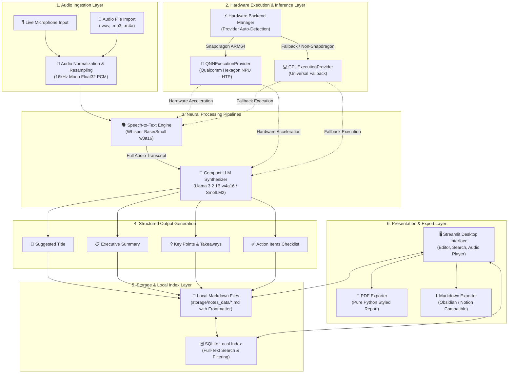

# OfflineMind - System Architecture & Technical Specifications

> **Built for the Snapdragon AI Lab Build & Present Challenge**  
> Target Platform: Snapdragon X Series HP PCs (Windows 11 on ARM64)

OfflineMind is engineered as a zero-cloud, privacy-preserving note synthesis system. It takes raw, unstructured audio from lectures, conferences, and meetings, transcribes it locally using Qualcomm Hexagon NPU-accelerated Whisper models, synthesizes key takeaways using compact on-device LLMs, and stores the results as searchable local Markdown files indexed in SQLite.

---

## High-Level Architecture Diagram

---

## Core Subsystems

### 1. Hardware Detection & QNN Execution Provider
The hardware layer (`core/backend.py`) inspects the host platform on startup:
- On Snapdragon X Series HP PCs (e.g. Snapdragon X Elite / X Plus running Windows on ARM64), it connects directly to `QNNExecutionProvider` targeting Qualcomm's Hexagon Tensor Processor (`QnnHtp.dll`).
- If executed on other hardware or during emulation, it automatically and gracefully routes inference to `CPUExecutionProvider` (or DirectML), guaranteeing that the application runs everywhere without crashing.
- Active provider status is surfaced directly to the UI badge.

### 2. Speech-to-Text Pipeline (Whisper)
- Input audio is chunked into 30-second windows and resampled to 16,000 Hz mono PCM.
- Uses Snapdragon-quantized Whisper models (`whisper_base_en`, `whisper_small_en`) with 8-bit weights and 16-bit activations (`w8a16`), optimizing throughput on the Hexagon NPU.
- Computes latency and Real-Time Factor ($RTF = \frac{\text{latency}}{\text{audio duration}}$).

### 3. Note Structuring Pipeline (Compact LLM)
- Transcripts are parsed by compact LLMs (such as Meta's Llama 3.2 1B or SmolLM2) running quantized (`w4a16`).
- Generates 4 strictly formatted deliverables:
  1. **Title:** Concise topic headline.
  2. **Executive Summary:** High-level narrative overview.
  3. **Key Points:** Core insights, formulas, and arguments.
  4. **Action Items:** Interactive checklist of deliverables and next steps.

### 4. Storage & Retrieval Architecture
- **Markdown with YAML Frontmatter:** Every note is a standalone text file, future-proof and readable by any editor (Obsidian, Logseq, VS Code).
- **SQLite Database Index:** Maintains note metadata (title, summary, tags, created timestamp, hardware backend) for instant keyword and tag search without scanning the entire file tree.

### 5. Export Engine
- Pure Python PDF generator creates high-resolution, paginated PDF documents with custom typography, summary callout boxes, and action item checkboxes.
